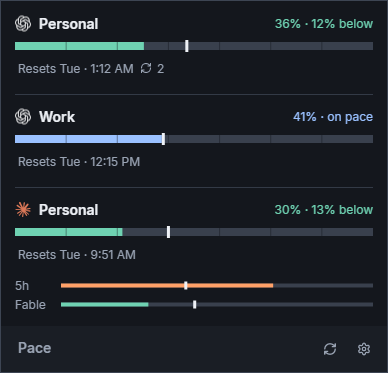
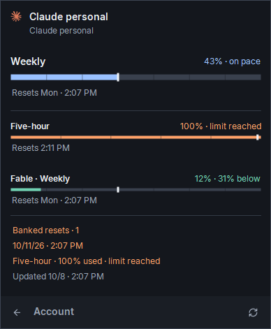
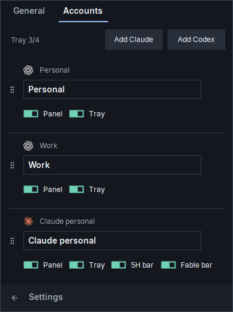
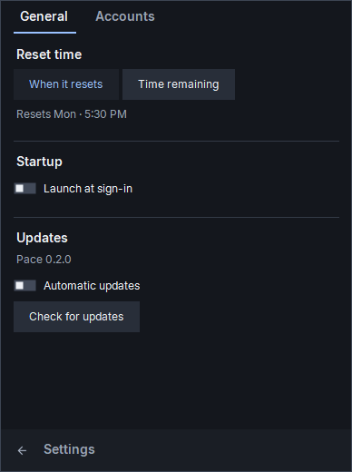

# Pace

A compact tray app for tracking AI subscription usage across Codex and Claude accounts on Windows, Linux and macOS. See how your usage compares with the time elapsed in each account's weekly cycle.



## Download

**[Windows](https://github.com/mweint/Pace/releases/latest/download/Pace-win-x64.zip)** — Extract the ZIP and open `Pace.exe` in the `Pace` folder. Windows 10/11, x64; .NET is included.

**[Linux (preview)](https://github.com/mweint/Pace/releases/latest/download/Pace-linux-x64.tar.gz)** — Extract the archive and run `./Pace/install.sh`. Requires an x64 desktop with X11 libraries and ICU. Tray support works with KDE Plasma or GNOME's AppIndicator extension. Linux still needs validation on real desktops.

**macOS (preview)** — [Apple silicon](https://github.com/mweint/Pace/releases/latest/download/Pace-osx-arm64.tar.gz) or [Intel](https://github.com/mweint/Pace/releases/latest/download/Pace-osx-x64.tar.gz). Open the archive, then run `sh ~/Downloads/Pace/install.sh` in Terminal; it installs Pace in `~/Applications` and opens it. Pace isn't notarized, so the installer clears the download quarantine and signs the app for your Mac. macOS 15 or later; .NET is included. macOS hasn't been tested on a real Mac yet: reports and pull requests are welcome ([test checklist](docs/macos-test-checklist.md)).

Existing CLI sign-ins are detected automatically. To add an account, install the corresponding Codex or Claude CLI and sign in through Pace. Click the tray icon to open the panel; on macOS, click the menu bar icon and choose Show Pace.

## Usage and accounts

- **Mint:** below pace. **Blue:** on pace. **Orange:** above pace. **Gray:** unavailable or stale.
- Pace compares usage with the elapsed portion of the week. On pace spans 4 percentage points below to 2 points above that baseline.
- Click an account for weekly, session and model limits. Reset times are local; hover for a countdown.
- Settings lets you rename, reorder or hide accounts, choose Claude's overview bars, and enable launch at sign-in. Removing an account keeps its sign-in files.
- Usage refreshes every five minutes. Update checks run at launch and every six hours; automatic updates are optional on Windows. Linux and macOS updates are downloaded manually.

<details>
<summary>More screenshots</summary>

Account details:



Accounts:



Settings:



Tray hover:


</details>

## Privacy

Credentials stay local and official CLIs manage sign-in and renewal. Tokens are sent only to the corresponding service. Pace has no telemetry. Settings and managed sign-ins live in `%APPDATA%/Pace` on Windows, `~/.config/Pace` on Linux and `~/Library/Application Support/Pace` on macOS. On macOS, Claude Code keeps sign-ins in the Keychain, and Pace reads them with Apple's `security` tool. Subscription endpoints are undocumented and may change.

<details>
<summary>Development</summary>

Built with Avalonia and .NET 10. See [STYLEGUIDE.txt](STYLEGUIDE.txt), [AGENTS.md](AGENTS.md), the [Linux test checklist](docs/linux-test-checklist.md) and the [macOS test checklist](docs/macos-test-checklist.md). Release packages are built with `scripts/Publish-Linux.ps1` and `scripts/Publish-Mac.ps1`.

```powershell
dotnet build -c Release
.\bin\Release\net10.0\Pace.exe --self-test .local/self-test.json
.\bin\Release\net10.0\Pace.exe --render-preview .local/overview.png
```

Offline checks and previews require an interactive desktop. Previews use synthetic accounts. Before committing or publishing, inspect the index and run `pwsh -File scripts/Verify-Repository.ps1`.

</details>

## Assets

- [Lucide icons](https://github.com/lucide-icons/lucide/tree/main/icons): ISC/Feather MIT notices in `Assets/Icons`.
- [Inter 4.1](https://github.com/rsms/inter/releases/tag/v4.1), by Rasmus Andersson: Pace Sans is a renamed derivative; SIL Open Font License and modification notice in `Assets/Fonts`.
- Original provider artwork: attribution in `Assets/Icons/Service-marks.txt`.
